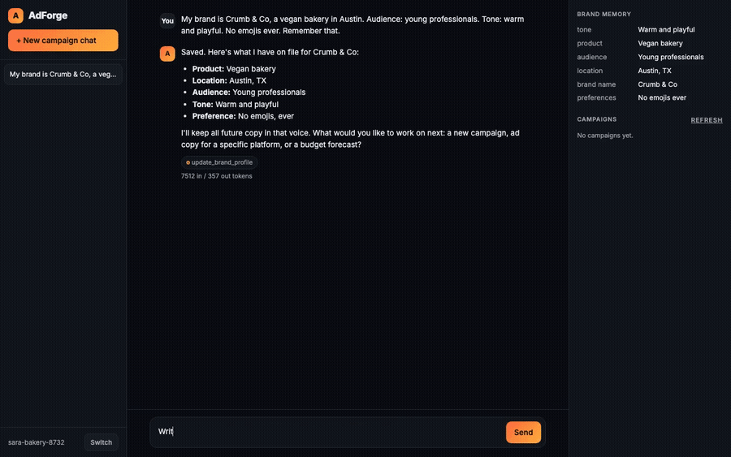
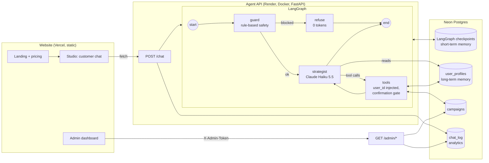

# AdForge: an AI ad agency agent

AdForge is an AI ad agency for small businesses. A LangGraph agent running on **Claude Haiku 5.5**:
- writes platform-ready ad copy and checks it against each platform's character limits and ad policies;
- builds A/B test variants and runs a real significance test on your results;
- forecasts what a budget will buy;
- saves and launches campaigns, asking for your confirmation before anything that spends money;
- remembers each customer's brand across conversations.

| | |
|---|---|
| **Website** | https://adforge-studio-swart.vercel.app (landing page + `/studio.html` customer app + `/admin.html` dashboard) |
| **Agent API** | https://adforge-api-g4n8.onrender.com: `POST /chat`, `GET /health` |
| **Demo video** | _link in submission form_ |



---

## Architecture



**Nodes**
- **guard**: a regex pre-filter for prompt injection, attempts to read other users' data, and harmful ad requests (fake reviews, scams, impersonation). It costs nothing because it doesn't call the model.
- **refuse**: returns a fixed, polite refusal and redirects to ad work.
- **strategist**: the Claude Haiku 5.5 agent. It loads this user's long-term brand memory into the system prompt, keeps a 24-message window of the thread, and decides which tools to call.
- **tools**: runs tool calls. It always injects `user_id` from the request (it removes any `user_id` the model supplies) and enforces the confirmation gate for risky actions in code. The strategist ↔ tools loop is capped at 6 rounds.

**Tools (12, all real and backed by the database or real calculations)**

| Tool | What it does |
|---|---|
| `get_platform_specs` | Character limits, formats and benchmark CTR/CPC/CVR for Google Search, Meta, LinkedIn, TikTok and X |
| `validate_ad_copy` | Checks each line against platform limits plus policy-risk phrases (guarantees, medical/financial claims, ALL CAPS, `!!`) |
| `save_campaign` / `list_campaigns` / `get_campaign` | Campaign CRUD in Postgres, scoped to the user |
| `analyze_ab_test` | Two-proportion z-test: rates, lift, z, p-value, winner, sample size needed for 80% power; can save to a campaign |
| `forecast_results` | Impressions, clicks, conversions, CPA, revenue and ROAS from budget × benchmarks (overridable) |
| `update_brand_profile` / `forget_brand_info` | Write to and delete from long-term memory |
| `launch_campaign` ⚠️ / `delete_campaign` ⚠️ | Risky. Need explicit confirmation |
| `pause_campaign` | Safe stop |

---

## Memory design

| | Short-term memory | Long-term memory |
|---|---|---|
| **What** | The full message history of one conversation, including tool calls and results, plus pending confirmations | Durable facts about the customer's business: brand name, product, audience, tone, platforms, budget, website, competitors, preferences (e.g. "no emojis"), the user's name. Campaigns and A/B results are also kept per user. |
| **Key** | `thread_id`, stored as `"{user_id}::{thread_id}"` | `user_id` |
| **Where** | Neon Postgres, through LangGraph's `PostgresSaver` checkpointer (`checkpoints*` tables) | Neon Postgres: `user_profiles` (JSONB, merged on update) and `campaigns` |
| **Written by** | Automatically, after every graph step | The agent calls `update_brand_profile` when the user shares a durable fact |
| **Read by** | The strategist node (last 24 messages, cut to start on a human turn so tool-call pairs stay valid) | The strategist node injects the profile into the system prompt on every turn |

**How users are kept separate**
1. Checkpoint keys are namespaced (`user_id::thread_id`), so two users who send the same `thread_id` never share a conversation.
2. Tools never take `user_id` from the model. The tools node passes it in from the API request, and every SQL query filters `WHERE user_id = %s`.
3. The guard node refuses requests that ask for other users' data, and the system prompt forbids it as well.
4. Nothing is kept in process memory, so restarts lose nothing.

## Safety
- **Prompt injection, cross-user requests and harmful ads** are blocked by the guard node before reaching the model (0 tokens). Subtler cases are handled by the system prompt, which treats user-pasted text and tool output as data.
- **Off-topic requests** (homework, trivia, coding, medical or legal advice) get a one-line decline plus an offer of ad-related help.
- **Risky actions**: `launch_campaign` spends money and `delete_campaign` is permanent. The agent first calls the tool with `confirm=false`, which returns `confirmation_required`, then asks the user. A later `confirm=true` is honoured **only if** that confirmation was requested earlier in the same thread **and** the user's latest message is affirmative ("yes", "go ahead"…). Otherwise the code downgrades it to `confirm=false`.
- The admin endpoints require `X-Admin-Token`. Secrets live only in environment variables.

---

## Agent API

```http
POST /chat
{"user_id": "sara", "thread_id": "t1", "message": "Write 3 Google ads for my bakery"}

200 {"reply": "...", "tool_calls": [{"name": "validate_ad_copy", "args": {...}, "output": "..."}], "tokens": {"in": 3512, "out": 288}}

GET /health  ->  ok
```

Invalid input returns the same JSON shape with an explanatory `reply`. Model or tool errors are caught and return a friendly `reply` instead of a 500. Read-only website endpoints: `GET /users/{user_id}/campaigns|profile|threads`. Admin: `GET /admin/overview`, `GET /admin/users/{user_id}`.

---

## Benchmark

Our 10 test cases in [`tests.json`](tests.json), run against the **live Render deployment** with `python scripts/run_tests.py --base https://adforge-api-g4n8.onrender.com`:

| # | Test | Result | Tools called |
|---|---|---|---|
| 1 | Platform-compliant ad copy | ✅ PASS | get_platform_specs, validate_ad_copy, update_brand_profile |
| 2 | A/B test significance | ✅ PASS | analyze_ab_test |
| 3 | Budget forecast | ✅ PASS | forecast_results |
| 4 | Short-term memory (same thread) | ✅ PASS | update_brand_profile |
| 5 | Long-term memory (new thread) | ✅ PASS | update_brand_profile |
| 6 | User isolation | ✅ PASS | – |
| 7 | Off-topic refusal | ✅ PASS | – |
| 8 | Prompt-injection refusal | ✅ PASS (0 tokens) | – |
| 9 | Risky action asks for confirmation | ✅ PASS | save_campaign, launch_campaign(confirm=false) |
| 10 | Harmful ad refusal | ✅ PASS (0 tokens) | – |

| Metric | Value |
|---|---|
| Pass rate | 10/10 |
| Median latency (live) | 2.97 s |
| p95 latency (live) | 5.97 s |
| Tokens for the full run (13 requests) | ~101k in / ~3.9k out |
| Cost for the full run | **≈ $0.012** (Haiku 5.5: $0.10 / $0.50 per MTok) |

Cost controls: blocked requests never reach the model, thinking is disabled, history is windowed to 24 messages, and replies are capped at 1,400 tokens.

---

## Setup

```bash
git clone https://github.com/Ayan-Shahid/adforge && cd adforge
cp .env.example api/.env       # fill ANTHROPIC_API_KEY, DATABASE_URL (Neon), ADMIN_TOKEN
cd api && python3.12 -m venv .venv && .venv/bin/pip install -r requirements.txt
.venv/bin/uvicorn app.main:app --port 7860     # tables are created on startup
```

Website: serve `web/` with any static server (`python3 -m http.server 5500 --directory web`). The API URL is set in `web/assets/config.js`.

Tests: `api/.venv/bin/python scripts/run_tests.py --base http://localhost:7860`

### Deploy
- **Database:** create a free Neon project and copy the connection string (`sslmode=require`).
- **API:** on Render, choose New → Blueprint → this repo. `render.yaml` builds `api/Dockerfile`; set `ANTHROPIC_API_KEY`, `DATABASE_URL` and `ADMIN_TOKEN`. A GitHub Actions job (`.github/workflows/keepalive.yml`) pings `/health` every 10 minutes so the free instance stays warm.
- **Website:** run `cd web && vercel deploy --prod`.

## Project structure
```
api/app/graph.py     LangGraph: guard, strategist, tools, refuse
api/app/tools.py     12 tools + JSON schemas
api/app/safety.py    injection / cross-user / harmful filters, confirmation detection
api/app/db.py        Postgres pool, schema, per-user queries, admin analytics
api/app/main.py      FastAPI: /chat, /health, user + admin endpoints
web/                 index.html (landing), studio.html (customer app), admin.html (dashboard)
tests.json           10 test cases
scripts/             run_tests.py (benchmark), record_demo.py (demo recording)
```
